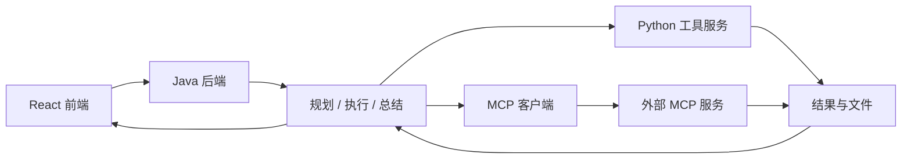

# FinPilot

面向金融信息检索与分析报告生成的 Agent 应用，使用 Java 后端编排任务，结合 Python 工具服务与 MCP 客户端完成搜索、代码解释、文件处理和报告生成，并通过前端展示执行进度与结果。

## 核心功能

- **任务编排**：通过 PlanningAgent、ExecutorAgent 和 SummaryAgent 完成任务规划、工具执行与结果汇总，支持 ReAct 执行模式。
- **工具接入**：统一管理搜索、代码解释、报告与文件工具，通过 MCP 客户端对接外部工具服务。
- **上下文管理**：维护任务信息和消息历史，关联工具调用结果，按配置截断过长结果并清理工具历史。
- **流式交互**：通过 SSE 展示任务计划、执行进度、工具结果和最终输出。

## 项目架构



| 模块 | 技术栈 | 目录 | 端口 |
| --- | --- | --- | --- |
| 前端 | React、TypeScript、Vite、Ant Design | `ui/` | 3000 |
| 后端 | Java 17、Spring Boot 3.2.2 | `genie-backend/` | 8080 |
| 工具服务 | Python、FastAPI、LiteLLM、SQLite | `genie-tool/` | 1601 |
| MCP 客户端 | Python、FastAPI、MCP SDK | `genie-client/` | 8188 |

## 本地运行

默认项目依赖已经安装，模型 API、搜索服务及 MCP 地址已完成配置。以下使用本地路径 `D:\CursorProjects\FinPilot`，请按实际存放位置调整。

在 **4 个独立的 PowerShell 终端**中分别执行以下指令。建议启动顺序：**工具服务 → MCP 客户端 → 后端 → 前端**。

### ① 前端（端口 3000）

```powershell
cd D:\CursorProjects\FinPilot\ui
$env:SERVICE_BASE_URL = "http://localhost:8080"
pnpm run dev
```

启动后访问：[http://localhost:3000](http://localhost:3000)。

### ② 后端（端口 8080）

```powershell
cd D:\CursorProjects\FinPilot\genie-backend
mvn org.springframework.boot:spring-boot-maven-plugin:3.2.2:run
```

### ③ Python 工具服务（端口 1601）

```powershell
cd D:\CursorProjects\FinPilot\genie-tool
$env:ENV = "prod"
.\.venv\Scripts\python.exe server.py --workers 1
```

这里关闭自动重载，使用一个工作进程，适合本地运行。需要修改代码后自动重启时，将 `"prod"` 改成 `"local"`。

### ④ MCP 客户端服务（端口 8188）

```powershell
cd D:\CursorProjects\FinPilot\genie-client
.\.venv\Scripts\python.exe server.py
```

健康检查：[http://localhost:8188/health](http://localhost:8188/health)。

启动后保持各终端运行，按 `Ctrl+C` 停止对应服务。

如果首次运行缺少依赖：前端目录执行 `pnpm install`；两个 Python 服务分别在各自目录执行 `uv sync --python 3.11`。

### 配置位置

- **Java 后端**：`genie-backend/src/main/resources/application.yml`，配置模型、工具服务及 MCP 地址；默认模型密钥从 `LLM_API_KEY` 环境变量读取。
- **Python 工具服务**：从 `genie-tool/.env_template` 复制生成 `.env`，填写模型与搜索服务配置；本地文件服务地址设为 `FILE_SERVER_URL=http://localhost:1601/v1/file_tool`。
- **前端**：通过 `SERVICE_BASE_URL` 指定后端地址，如上述启动命令所示。

## 使用示例

```text
检索某上市公司最近一期公开财报，整理营业收入、净利润和主要业务变化，
注明报告期、数据单位与来源，生成一份中文分析报告。
缺少的数据请明确标注，不要自行补全。
```

该输入可用于检查任务规划、工具调用、结果回填和报告生成流程，实际效果取决于模型及工具服务配置。

## 实现说明

- 规划与执行分别配置提示词，结合用户需求、工具描述和文件信息完成多步骤任务。当前 `planner.close_update=1`，默认按已有计划推进。
- `ToolCollection` 统一分发工具调用；Java 通过 HTTP 调用 MCP 客户端，再由客户端连接外部 SSE MCP 服务。
- 工具结果通过 `tool_call_id` 关联，结合结果长度限制与任务结束后的历史清理控制上下文规模。

仓库保留了 Genie 模块命名和原文件作者注释；项目来源及授权范围应结合上游信息核对，当前未提供根目录 `LICENSE`。
